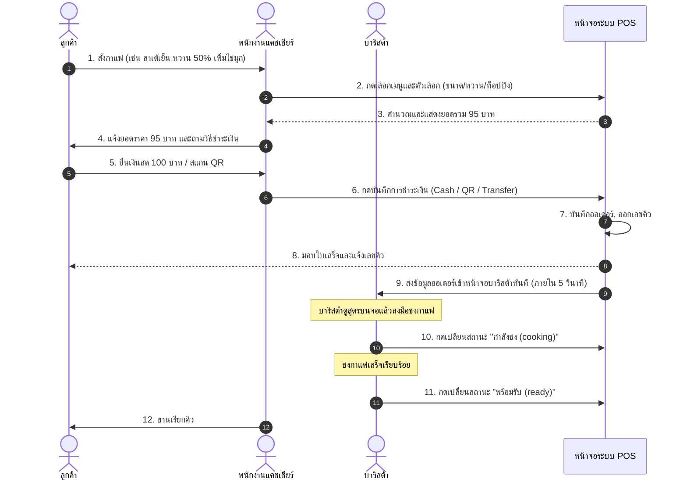
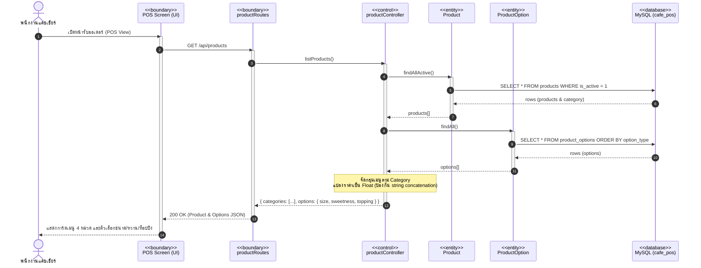
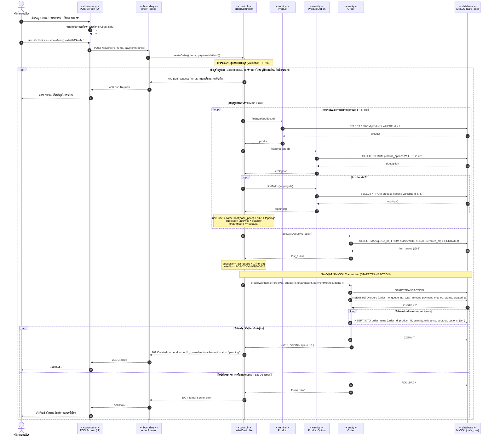
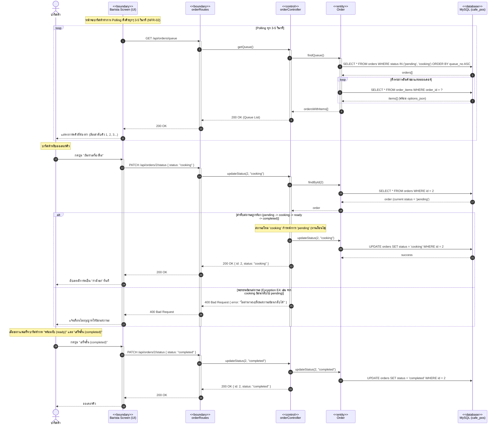

# Sequence Diagrams: ระบบ Coffee Shop POS (System Analysis & Design)

เอกสารการออกแบบ **Sequence Diagrams** ตามมาตรฐาน UML 2.x และสถาปัตยกรรม **BCE / BCM (Boundary-Control-Entity)** โดยอ้างอิงเนื้อหาจากสไลด์บทเรียน [Sequence.pdf](file:///c:/691-88734065%20System%20Analysis%20and%20Designs/Project-POS/lesson/Sequence.pdf) (หัวข้อ 9, 10, และ 11) และเชื่อมโยงกับข้อกำหนดความต้องการ [wk03-requirements.md](file:///c:/691-88734065%20System%20Analysis%20and%20Designs/Project-POS/lesson/wk03-requirements.md) และ [wk04-user-stories.md](file:///c:/691-88734065%20System%20Analysis%20and%20Designs/Project-POS/lesson/wk04-user-stories.md)

---

## 1. ภาพรวมกระบวนการทางธุรกิจในชีวิตจริง (Business Process Sequence Diagram)

_อ้างอิง: Sequence.pdf หัวข้อ 6.1 การสั่งกาแฟที่ร้านคาเฟ่ (Ordering Coffee)_

แผนภาพนี้แสดงลำดับเหตุการณ์การมีปฏิสัมพันธ์ระหว่างคนในชีวิตจริง (ลูกค้า, พนักงานแคชเชียร์, และบาริสต้า) ก่อนแปลงเป็นซอฟต์แวร์

---

## 2. แผนภาพซอฟต์แวร์มุมมอง BCE (Boundary-Control-Entity)

_อ้างอิง: Sequence.pdf หัวข้อ 10 และ 11 (Checkout & Order Flow ในมุมมอง BCE)_

ในการพัฒนาซอฟต์แวร์ Lifeline จะถูกแบ่งออกตามหน้าที่ของสถาปัตยกรรม BCM:

- **`<<boundary>>`**: หน้าจอผู้ใช้ (Frontend Screen) หรือ API Route ที่รับข้อมูลเข้าสู่ระบบ
- **`<<control>>`**: คลาสหรือฟังก์ชัน Controller ที่ทำหน้าที่ควบคุม Flow และการตัดสินใจตามกฎเกณฑ์ธุรกิจ (Business Logic)
- **`<<entity>>`**: คลาสข้อมูลสำหรับเข้าถึงฐานข้อมูล MySQL โดยตรง

---

### แผนภาพที่ 1: การโหลดเมนูและตัวเลือกสินค้า (FR-01, FR-02)

_Use Case 01: รับออเดอร์ «include» UC-02 เลือกเมนู ขนาด ความหวาน และท็อปปิง_

---

### แผนภาพที่ 2: การสั่งซื้อ คำนวณราคา ออกเลขคิว และชำระเงิน (FR-03, FR-04, FR-05, FR-06, FR-07)

_Use Case 01: รับออเดอร์ «include» UC-02 (ตัวเลือก) และ UC-03 (บันทึกวิธีชำระเงิน)_  
_ครอบคลุม Main Flow, Alternative Flow (A1) และ Exception Flows (E1: ข้อมูลไม่ครบ, E3: Rollback Transaction)_

---

### แผนภาพที่ 3: บาริสต้าดูคิวแบบเรียลไทม์ และอัปเดตสถานะเครื่องดื่ม (FR-07, FR-08)

_Use Case 04: ดูคิวออเดอร์และอัปเดตสถานะ_  
_แสดงการทำงานแบบ Polling และการควบคุม State Transition ห้ามย้อนสถานะ (Exception E4)_

---

## 3. สรุปความเชื่อมโยงกับโค้ดจริง (Code Traceability)

| ส่วนประกอบใน Diagram            | ประเภท BCE     | ไฟล์ที่นำไปปฏิบัติจริง                     | ฟังก์ชัน/ความรับผิดชอบ                              |
| ------------------------------- | -------------- | ------------------------------------------ | --------------------------------------------------- |
| **POS Screen**                  | `<<boundary>>` | `project/frontend/cashier/`                | หน้าจอรับออเดอร์, ตะกร้าสินค้า, แสดงเลขคิว          |
| **Barista Screen**              | `<<boundary>>` | `project/frontend/barista/`                | หน้าจอดูคิวแบบ Card/Kanban, Polling ออเดอร์         |
| **orderRoutes / productRoutes** | `<<boundary>>` | `backend/routes/*.js`                      | จัดการ HTTP Request, Path, Method, Parameters       |
| **productController**           | `<<control>>`  | `backend/controllers/productController.js` | จัดกลุ่มสินค้าตามหมวดหมู่, แปลงประเภทข้อมูลทศนิยม   |
| **orderController**             | `<<control>>`  | `backend/controllers/orderController.js`   | คำนวณราคา, Validate ข้อมูล, ออกเลขคิว, ลำดับสถานะ   |
| **Product / ProductOption**     | `<<entity>>`   | `backend/entities/Product*.js`             | รันคำสั่ง SQL ดึงเมนูและตัวเลือก                    |
| **Order**                       | `<<entity>>`   | `backend/entities/Order.js`                | บันทึกออเดอร์ด้วย MySQL Transaction, ดึงรายการคิว   |
| **MySQL (cafe_pos)**            | `<<database>>` | `backend/db.js`                            | Connection Pool, ตาราง `orders`, `order_items`, ฯลฯ |
