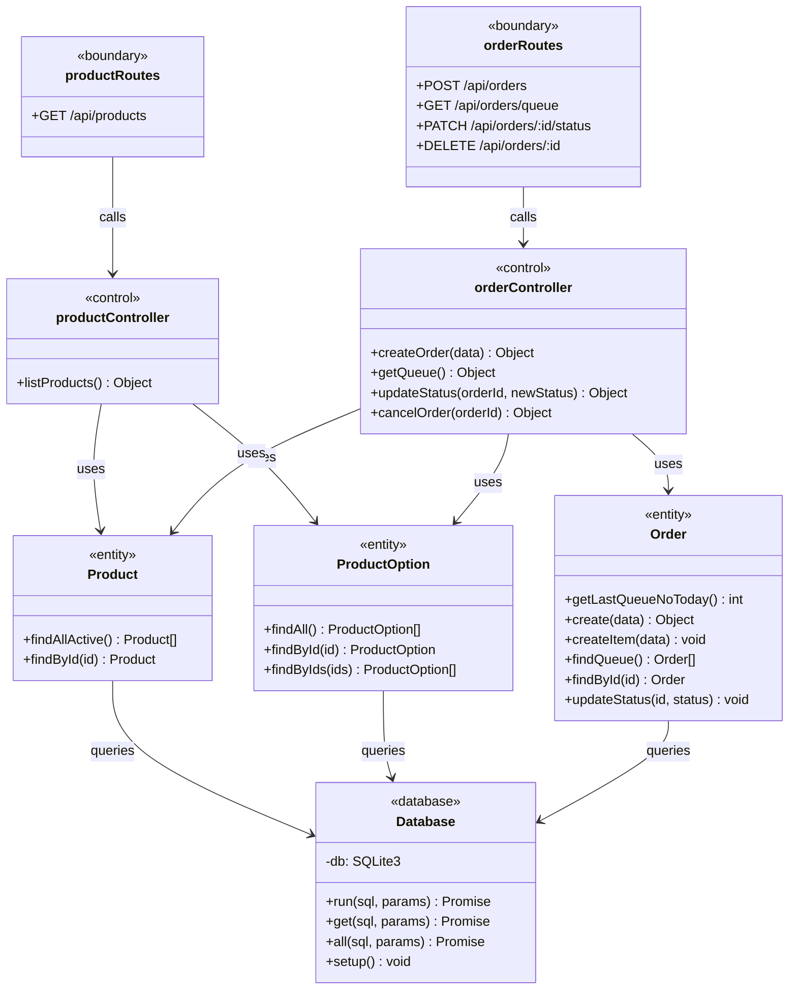

# wk06-class-diagram.md: แผนภาพ Class Diagram และ Object Diagram

# ระบบ Coffee Shop POS

**รายวิชา:** 88734065 การวิเคราะห์และออกแบบระบบ  
**กิจกรรม:** Workshop สัปดาห์ที่ 6 — Class Diagram & Object Diagram

> **หมายเหตุ:** เอกสารนี้สร้างขึ้นโดย Reverse Engineering จากโค้ดจริงที่พัฒนาแล้ว  
> ตาม BCM (Boundary-Control-Entity) Architecture ที่ใช้จริงในโปรเจกต์

---

## 1. Class Diagram (UML 2.x)



---

## 2. Object Diagram — ตัวอย่างออเดอร์จริงในระบบ

```mermaid
classDiagram
    direction LR

    class order1 {
        id = 1
        order_no = "POS-20261018-0001"
        queue_no = 1
        total_amount = 95
        payment_method = "qr"
        status = "pending"
        created_at = "2026-10-18 16:30:00"
    }

    class item1 {
        id = 1
        order_id = 1
        product_id = 3
        quantity = 1
        unit_price = 80
        subtotal = 80
        options_json = "{sizeId:2, sweetnessId:6, toppingIds:[9]}"
    }

    class item2 {
        id = 2
        order_id = 1
        product_id = 9
        quantity = 1
        unit_price = 55
        subtotal = 55
        options_json = "{sizeId:1, sweetnessId:null, toppingIds:[]}"
    }

    class productLatte {
        id = 3
        name = "ลาเต้ (Latte)"
        base_price = 60
        category_id = 1
    }

    class sizeM {
        id = 2
        option_type = "size"
        name = "M"
        extra_price = 10
    }

    class toppingPearl {
        id = 9
        option_type = "topping"
        name = "ไข่มุก"
        extra_price = 15
    }

    order1 "1" --> "1..*" item1 : contains
    order1 "1" --> "1..*" item2 : contains
    item1 --> productLatte : references
    item1 --> sizeM : uses
    item1 --> toppingPearl : uses
```

---

## 3. สรุปหน้าที่ของแต่ละ Class ตาม BCM Pattern

| Class               | Layer          | หน้าที่                                                                        | ไฟล์จริง                           |
| ------------------- | -------------- | ------------------------------------------------------------------------------ | ---------------------------------- |
| `productRoutes`     | Boundary       | รับ HTTP GET /api/products ส่งให้ Controller                                   | `routes/productRoutes.js`          |
| `orderRoutes`       | Boundary       | รับ HTTP POST/GET/PATCH/DELETE สำหรับออเดอร์                                   | `routes/orderRoutes.js`            |
| `productController` | Control        | จัดกลุ่มเมนูตาม category แปลง base_price เป็น float                            | `controllers/productController.js` |
| `orderController`   | Control        | Validate (FR-03), คำนวณราคา (FR-05), ออกเลขคิว (FR-04), ตรวจลำดับสถานะ (FR-08) | `controllers/orderController.js`   |
| `Product`           | Entity         | SELECT จาก `products` + `categories`                                           | `entities/Product.js`              |
| `ProductOption`     | Entity         | SELECT จาก `product_options`                                                   | `entities/ProductOption.js`        |
| `Order`             | Entity         | INSERT/SELECT/UPDATE ตาราง `orders` และ `order_items`                          | `entities/Order.js`                |
| `Database`          | Infrastructure | SQLite3 Promise Wrapper (`run`, `get`, `all`), Auto-setup schema               | `db.js`                            |
