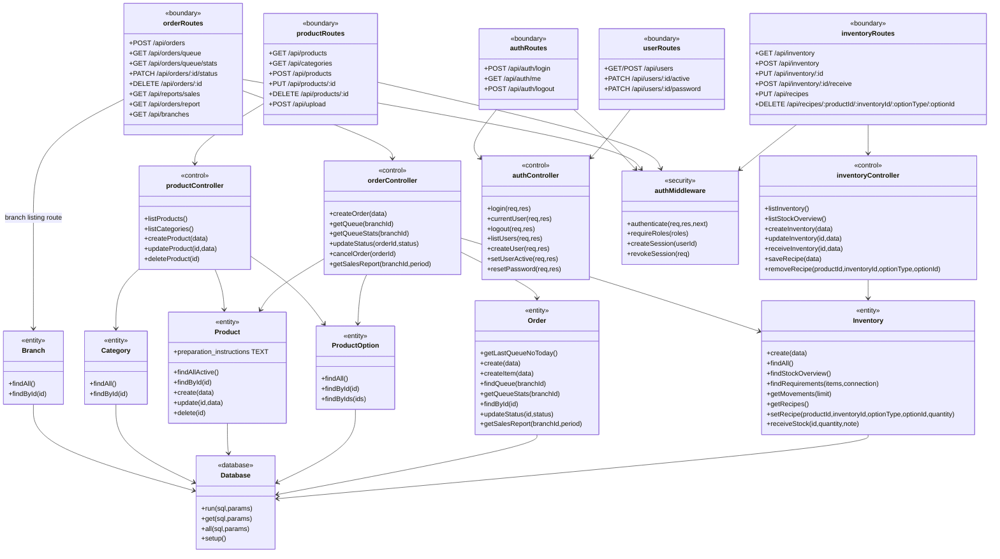
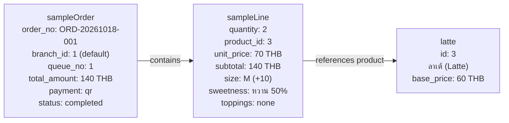

# Class Diagram ของระบบตาม Source

**สัปดาห์:** 06 — Object-Oriented Analysis & Design
**แหล่งอ้างอิง:** source ใน `project/backend/`
**รายละเอียดข้อจำกัด:** [as-built reverse-engineering](./as-built-reverse-engineering.md)

`Product` เก็บคำแนะนำวิธีชงที่เจ้าของร้านแก้ไขได้; `Order.createItem()` รับ snapshot ใน `options_json` ผ่าน `orderController` เพื่อให้ข้อมูลคงเดิมในคิวที่สร้างแล้ว

## Object Diagram จากข้อมูล Seed

แผนภาพนี้เป็น snapshot เชิงตัวอย่างที่ผูกกับข้อมูล seed ใน `backend/db.js` ไม่ใช่ข้อมูลจากการสั่งซื้อสดใน runtime: seed สร้างสินค้า ID 3 เป็นลาเต้, สร้าง order ตัวอย่างเลข `ORD-20261018-001` และผูก order item จำนวน 2 แก้ว ราคาแก้วละ 70 บาท ยอด 140 บาท ตัวแปร primary key ของ order และ item ขึ้นกับฐานข้อมูลที่เริ่มต้น จึงแสดงเป็น `sampleOrder` และ `sampleLine` แทนการสมมติ ID ทั้งนี้สาขาไม่ได้ระบุใน seed order โดยตรงและมีค่า default เป็นสาขา 1.

ค่าที่แสดงอ้างจาก `seedSampleOrders()` และ `seedMockData()`; เวลา `created_at` ถูกสร้างแบบ relative จากเวลาที่ seed ทำงานจึงไม่กำหนดเป็นค่าคงที่ใน diagram นี้

## การตีความ

Class diagram สรุป boundary/control/entity/security ของ backend ที่มีจริง ไม่ได้แสดง frontend React components เพื่อให้เห็น backend BCM ชัดเจน เส้นทาง upload และ branch listing ทำงานใน route โดยตรง ไม่มีเมธอดใน controller. `Order.getSalesReport()` เป็น query ที่รวมรายงานอยู่ใน Entity ด้วย จึงไม่ใช่ Entity ที่มีแต่ CRUD อย่างเดียว. Inventory GET แยก `listStockOverview()` สำหรับ role barista ออกจาก response รายละเอียดสำหรับ owner; mutation ยัง owner-only. Object Diagram แสดง seed fixture ที่ระบุแหล่งไว้ ไม่ใช่หลักฐานของ order ปัจจุบันหรือผลทดสอบ runtime
