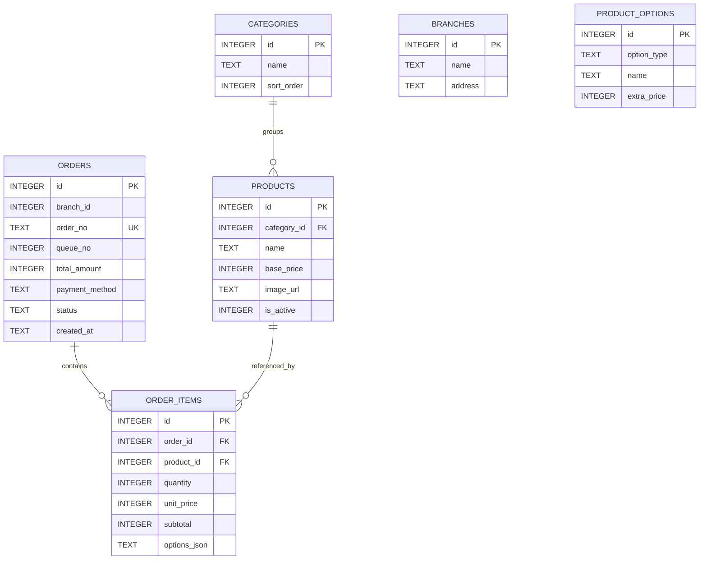

# ER Diagram ตาม SQLite runtime

**สัปดาห์:** 07 — ER Diagram & Database Design
**แหล่งยืนยัน:** `project/backend/db.js`
**DDL reference:** [wk07-schema.sql](./wk07-schema.sql) และ [backend/schema.sql](../backend/schema.sql)

> Diagram นี้แสดงตารางแกนหลัก 6 ตารางเพื่อให้อ่านความสัมพันธ์ได้ง่าย; runtime มีตารางเพิ่มเติมสำหรับคลัง สูตร movement migration และบัญชี ดูรายการครบใน SRS/as-built. `db.js` เปิด `PRAGMA foreign_keys = ON` ใน startup connection; `orders.branch_id` ไม่มี FK ที่ประกาศใน DDL. `options_json` เก็บ snapshot ของตัวเลือก จึงไม่มี FK จาก `order_items` ไป `product_options`.

## ความหมายและข้อจำกัด

- ER diagram หน้านี้วาด 6 ตารางหลัก: `branches`, `categories`, `products`, `product_options`, `orders`, `order_items`; runtime รวม 13 ตารางตาม [as-built](./as-built-reverse-engineering.md).
- `orders.branch_id` เป็น integer มี default 1 แต่ DDL runtime ไม่ประกาศ Foreign Key ไป `branches`.
- `order_no` มี unique constraint; `queue_no` ไม่มี unique constraint.
- `products.base_price`, `product_options.extra_price`, `orders.total_amount`, `order_items.unit_price/subtotal` ใช้ INTEGER ใน SQLite.
- `order_items.options_json` บันทึก selected option IDs/names, topping arrays, bakery selection, `isBakery` และ snapshot `inventoryConsumptions`.
- Product delete เป็น soft delete (`is_active=0`), ไม่ลบ order history.
- Runtime DDL อยู่ใน `backend/db.js`; SQL file เป็น reference, startup ไม่ execute ไฟล์นั้น.
