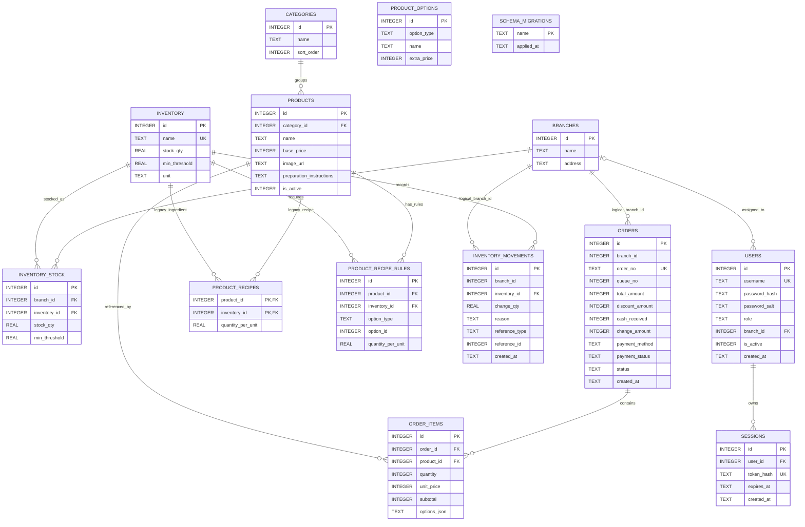

# ER Diagram ตาม SQLite runtime

**สัปดาห์:** 07 — ER Diagram & Database Design
**แหล่งยืนยัน:** `project/backend/db.js`
**DDL reference:** [wk07-schema.sql](./wk07-schema.sql) และ [backend/schema.sql](../backend/schema.sql)

> Diagram นี้แสดงตาราง runtime ทั้ง 14 ตารางตาม `backend/db.js`. `db.js` เปิด `PRAGMA foreign_keys = ON` ใน startup connection. `orders.branch_id` และ `inventory_movements.branch_id` ใช้ผูกสาขาใน logic แต่ไม่มี FK ที่ประกาศใน DDL. `options_json` เก็บ snapshot ของตัวเลือก จึงไม่มี FK จาก `order_items` ไป `product_options`.

## ความหมายและข้อจำกัด

- ER diagram แสดง 14 ตารางที่ runtime สร้าง; `inventory_stock` เก็บยอดและ threshold แยกสาขา, `schema_migrations` เป็น metadata สำหรับ migration และ `product_recipes` เป็นโครงสร้าง legacy ที่ใช้ย้ายสูตรรุ่นเก่า.
- `orders.branch_id` เป็น integer มี default 1 และ `inventory_movements.branch_id` ระบุสาขา แต่ DDL runtime ไม่ประกาศ Foreign Key ไป `branches` สำหรับสองคอลัมน์นี้. `users.branch_id` มี FK ไป `branches`; เป็นค่าว่างได้สำหรับ owner.
- `order_no` มี unique constraint; `queue_no` ไม่มี unique constraint.
- `inventory_stock` มี unique constraint ร่วม `(branch_id, inventory_id)`; `product_recipe_rules` มี unique constraint ร่วม `(product_id, inventory_id, option_type, option_id)`.
- `products.base_price`, `product_options.extra_price`, `orders.total_amount`, `order_items.unit_price/subtotal` ใช้ INTEGER ใน SQLite.
- `products.preparation_instructions` เก็บข้อความวิธีชงที่เจ้าของร้านตั้งต่อเมนู; เมื่อสร้างออเดอร์ข้อความจะถูก snapshot ลง `order_items.options_json` เพื่อคงคำแนะนำเดิมของรายการที่เข้าคิวแล้ว.
- `order_items.options_json` บันทึก selected option IDs/names, topping arrays, bakery selection, `isBakery`, snapshot `inventoryConsumptions` และ `preparationInstructions`.
- Product delete เป็น soft delete (`is_active=0`), ไม่ลบ order history.
- Runtime DDL อยู่ใน `backend/db.js`; SQL file เป็น reference, startup ไม่ execute ไฟล์นั้น.
