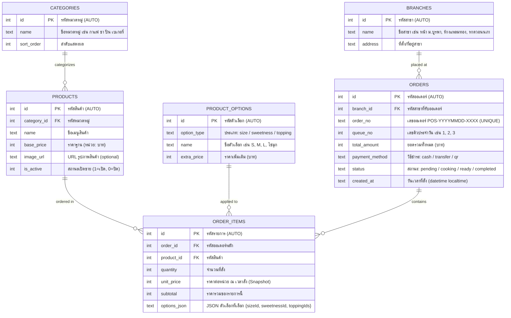

# เอกสารออกแบบ ER Diagram ระบบ Coffee Shop POS

**รายวิชา:** 88734065 การวิเคราะห์และออกแบบระบบ (System Analysis and Design)  
**กิจกรรม:** Workshop สัปดาห์ที่ 7 — ER Diagram & Database Design

---

## 1. แผนภาพ Entity-Relationship Diagram (Mermaid)

---

## 2. ตารางสรุปรายละเอียด Entity, Primary Key, Foreign Key และ Attribute

| Entity                | Primary Key (PK) | Foreign Key (FK)                                   | Attributes อื่นๆ                                                                              | หน้าที่ในระบบ                                                                         |
| :-------------------- | :--------------- | :------------------------------------------------- | :-------------------------------------------------------------------------------------------- | :------------------------------------------------------------------------------------ |
| **`BRANCHES`**        | `id`             | —                                                  | `name`, `address`                                                                             | จัดเก็บข้อมูลสาขาของร้านกาแฟ (รองรับระบบ Multi-branch)                                |
| **`CATEGORIES`**      | `id`             | —                                                  | `name`, `sort_order`                                                                          | แยกประเภทเมนู (กาแฟ, ชา, ปั่น, เบเกอรี่) รองรับ 3NF                                   |
| **`PRODUCTS`**        | `id`             | `category_id` → `CATEGORIES`                       | `name`, `base_price`, `image_url`, `is_active`                                                | เก็บข้อมูลเมนูสินค้าและราคาฐาน (รองรับ Soft delete ผ่าน is_active)                    |
| **`PRODUCT_OPTIONS`** | `id`             | —                                                  | `option_type`, `name`, `extra_price`                                                          | ตัวเลือกขนาด/ความหวาน/ท็อปปิง รวมในตาราง Single ตาม option_type                       |
| **`ORDERS`**          | `id`             | `branch_id` → `BRANCHES`                           | `branch_id`, `order_no`, `queue_no`, `total_amount`, `payment_method`, `status`, `created_at` | หัวออเดอร์หลัก เก็บยอดรวม วิธีชำระ สถานะคิว และสาขาที่สั่ง                            |
| **`ORDER_ITEMS`**     | `id`             | `order_id` → `ORDERS` `product_id` → `PRODUCTS` | `quantity`, `unit_price`, `subtotal`, `options_json`                                          | Associative Entity แก้ M:N ระหว่าง ORDERS-PRODUCTS เก็บ Snapshot ราคาและตัวเลือก JSON |

---

## 3. รายละเอียดความสัมพันธ์และ Cardinality

1. **`CATEGORIES` (1) — (N) `PRODUCTS` (One-to-Many):**  
   หนึ่งหมวดหมู่มีเมนูได้หลายรายการ แต่ละเมนูจัดอยู่ในหมวดหมู่เดียว

2. **`PRODUCTS` (1) — (N) `ORDER_ITEMS` (One-to-Many / Aggregation):**  
   เมนูหนึ่งรายการสามารถถูกสั่งในออเดอร์ต่างๆ ได้หลายครั้ง

3. **`PRODUCT_OPTIONS` (1) — (N) `ORDER_ITEMS` (One-to-Many):**  
   ตัวเลือกหนึ่งรายการ (เช่น ขนาด M) สามารถถูกเลือกในออเดอร์ได้หลายรายการ โดยเก็บเป็น JSON (`options_json`) ใน order_items

4. **`ORDERS` (1) — (N) `ORDER_ITEMS` (One-to-Many / Composition):**  
   หนึ่งออเดอร์ประกอบด้วยรายการสินค้าหลายรายการ ลบออเดอร์แล้ว order_items ถูกลบตาม (`ON DELETE CASCADE`)

---

## 4. เหตุผลในการออกแบบที่สำคัญ

- **`PRODUCT_OPTIONS` เก็บรวมกัน 1 ตาราง**: ใช้ `option_type` แบ่งระหว่าง `size`, `sweetness`, `topping` แทนการสร้าง 3 ตารางแยก เพื่อลดความซับซ้อนและง่ายต่อการ Query
- **`options_json` ใน ORDER_ITEMS**: เก็บตัวเลือกที่เลือกเป็น JSON แทนการ JOIN ตาราง เพื่อรองรับกรณีตัวเลือกหลายรายการ (toppings หลายอย่าง) และ Snapshot ณ เวลาสั่งซื้อ
- **`unit_price` Snapshot**: เก็บราคา ณ เวลาที่สั่งซื้อ ไม่อ้างอิง `base_price` ปัจจุบัน เพื่อป้องกัน Update Anomaly เมื่อเจ้าของปรับราคาในภายหลัง
- **`is_active`**: ซ่อนเมนูแทนการลบ เพื่อรักษาความสมบูรณ์ของข้อมูลออเดอร์เดิม (Referential Integrity)
