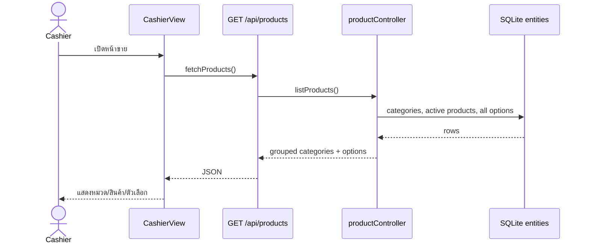
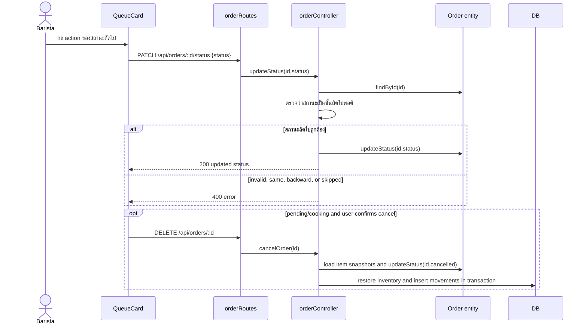
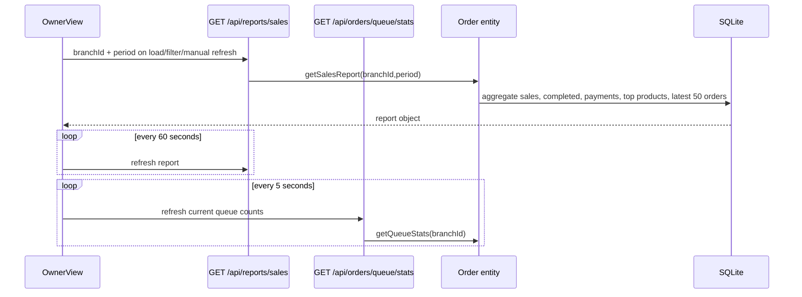
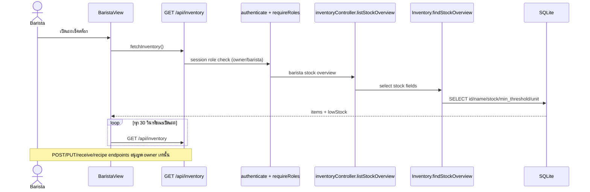

# Sequence Diagrams ตามคำขอจริงใน Source

**สัปดาห์:** 09 — System Sequence / BCM Flow
**รายละเอียดประกอบ:** [as-built reverse-engineering](./as-built-reverse-engineering.md)

## 1. โหลดเมนู



## 2. สร้างออเดอร์และอ่านคิว

```mermaid
sequenceDiagram
  actor Cashier
  participant UI as CashierView / CartSidebar
  participant Route as POST /api/orders
  participant Controller as orderController
  participant Entities as Product / ProductOption / Inventory / Order
  participant DB as SQLite
  participant Barista as BaristaView
  Cashier->>UI: เลือกสินค้า, options, payment method
  UI->>Route: items + paymentMethod + branchId
  Route->>Controller: createOrder(data)
  Controller->>Entities: load product (including preparation instructions), validate options and calculate price
  Controller->>DB: BEGIN IMMEDIATE transaction
  Controller->>Entities: load matching recipe rules and stock
  Entities->>DB: SELECT product/options/recipe rules/stock
  DB-->>Entities: rows
  Controller->>Controller: validate inventory availability, snapshot usage
  Controller->>Controller: add preparation instructions to item options snapshot
  Controller->>Entities: get next queue, create order + line items
  Entities->>DB: INSERT orders and order_items
  Controller->>DB: decrement inventory and insert movements
  Controller->>DB: COMMIT
  Controller-->>UI: 201 order number, queue number, amount, status
  UI-->>Cashier: show receipt; optional browser print
  loop every 3 seconds
    Barista->>Route: GET /api/orders/queue?branchId=...
    Route->>DB: read order_items.options_json snapshots
    DB-->>Route: selected options and preparation instructions
    Route-->>Barista: pending/cooking/ready orders and item instructions
  end
```

หาก validation, stock check หรือการเขียนรายการใดล้มเหลว transaction จะ rollback การจองคิว, order, items และ stock movement พร้อมกัน.

ตอนสร้างออเดอร์ ระบบคัดลอกชื่อวัตถุดิบ หน่วย และปริมาณที่จับคู่ได้จากสูตรจริงไปไว้ใน `options_json.inventoryConsumptions` พร้อม snapshot ตัวเลือก; QueueCard ใช้ข้อมูลชุดนี้แสดงสูตรให้บาริสต้า และไม่คำนวณจากสูตรปัจจุบันซ้ำเมื่ออ่านคิว. คำแนะนำข้อความจาก `products.preparation_instructions` เป็นข้อมูลเสริมและแสดงแยกจากสูตรตัดสต็อก.

## 3. อัปเดตสถานะหรือยกเลิก



Backend ยอมให้เปลี่ยนไปสถานะถัดไปทีละหนึ่งขั้นเท่านั้น; cancellation ทำได้เฉพาะ pending/cooking และคืน stock ตาม `inventoryConsumptions` snapshot ของ order item.

## 4. Owner report refresh



ตัวเลข queue summary เป็น polling แยกจาก sales report. ไม่ใช่ WebSocket หรือ push update

## 5. Barista อ่าน stock overview


