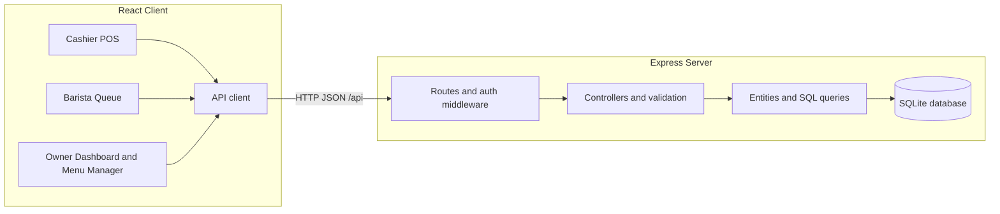
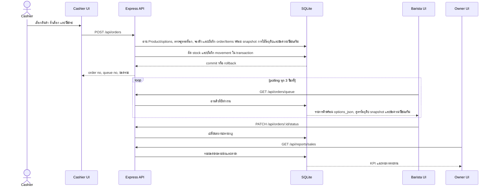
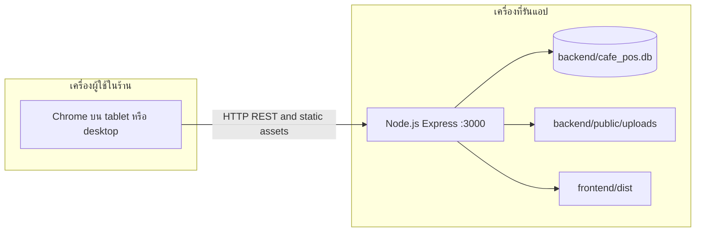

# สถาปัตยกรรมระบบ Coffee Shop POS แบบ 4+1 View

**สัปดาห์:** 11 — Architecture
**วันที่ตรวจ source:** 19 ตุลาคม 2026
**อ้างอิง:** [as-built reverse-engineering](./as-built-reverse-engineering.md)

เอกสารนี้จัดสถาปัตยกรรมตามกรอบ 4+1 โดยสรุปมุมมองเชิงตรรกะ (Logical), การพัฒนา (Development), กระบวนการทำงาน (Process), การติดตั้งใช้งาน (Physical) และสถานการณ์ที่ใช้ตรวจว่ามุมมองทั้งสี่เชื่อมกันอย่างไร (Scenarios) รายละเอียดสะท้อน source ปัจจุบัน ไม่ได้อ้างว่าระบบเป็น distributed service หรือมี push แบบ real-time

## 1. Logical View — โครงสร้างเชิงหน้าที่

ระบบแบ่งหน้าที่หลักเป็น client UI, REST boundary, business control, data access และ SQLite โดย frontend แยกหน้าตามบทบาท ขณะที่ backend รวม use cases ผ่าน route/controller/entity.



หน้าขายสร้างคำสั่งซื้อและเรียก API; บาริสต้าดึงคิวที่มีตัวเลือก สูตรวัตถุดิบจาก snapshot ที่ใช้ตัดสต็อก และข้อความวิธีชงเสริม เปลี่ยนสถานะ และอ่าน stock overview ได้; Owner ดูรายงาน จัดการเมนู (รวมวิธีชง) ผู้ใช้ และวัตถุดิบ. Role guard จำกัด API ตามบทบาท โดยเฉพาะ inventory GET เปิดให้ owner/barista แต่ mutation เปิดให้ owner. การตัดสต็อกและการบันทึกออเดอร์อยู่ใน SQLite transaction ตาม implementation.

## 2. Development View — โครงสร้างซอร์ส

```text
backend/
  server.js
  db.js
  auth/middleware.js
  routes/                 HTTP routes
  controllers/            validation and use-case logic
  entities/               SQLite queries
frontend/src/
  App.jsx
  services/api.js
  components/
    cashier/               POS and checkout
    barista/               queue and status actions
    owner/                 dashboard, menus, inventory
```

`MenuManager.jsx` แก้คำแนะนำวิธีชงในข้อมูล Product; `QueueCard.jsx` แสดงสูตรวัตถุดิบจาก `inventoryConsumptions` snapshot ที่ใช้ตัดสต็อกจริง และแสดง `preparationInstructions` เป็นข้อความเสริมแยกกัน. คิวเก่าที่ snapshot มีเพียง ID/ปริมาณอาจเติมชื่อและหน่วยจากข้อมูลคลังปัจจุบันตาม logic ของ `Order.findQueue()`.

Backend ใช้ Node.js/Express และ `sqlite3`; startup สร้าง/migrate schema และ seed ข้อมูลรวม inventory น้ำตาลกับ recipe rules ตามระดับความหวาน. Runtime มี 14 ตารางรวม `inventory_stock` สำหรับยอดแยกสาขา; `product_recipes` คงไว้เพื่อ migration compatibility ขณะที่ `product_recipe_rules` เป็นกฎสูตรปัจจุบัน. บัญชีพนักงานผูก `branch_id` เพื่อจำกัดคิวและการเปิดออเดอร์ตามสาขา. Frontend ใช้ React 19 และ Vite. เส้นทาง upload และ branch listing บางส่วนถูกจัดการใน route โดยตรง จึงไม่ใช่การแยก BCM ที่สมบูรณ์ทุกกรณี.

## 3. Process View — กระบวนการขณะทำงาน



Barista polling ทุก 3 วินาที, Owner queue counts ทุก 5 วินาที และ Owner sales report ทุก 60 วินาที. ไม่มี WebSocket/SSE. เวลาที่เห็นบนจอจึงขึ้นกับรอบ polling และ network/render.

## 4. Physical View — การติดตั้งใช้งาน



โหมดพัฒนาใช้ Vite ที่พอร์ต 5173 และ proxy `/api`, `/uploads` ไป backend พอร์ต 3000. โหมด server เดียวให้ Express ส่ง `frontend/dist` และไฟล์ upload. SQLite เป็นไฟล์บน host เดียว ไม่ใช่ฐานข้อมูลเครือข่ายแยกต่างหาก; การเปิดหลายเครื่องจึงต้องเข้าถึง host ที่ให้บริการผ่านเครือข่ายร้าน.

## 5. Scenarios — สถานการณ์เชื่อมโยงมุมมอง

### Scenario A: รับออเดอร์และส่งเข้าคิว

แคชเชียร์เลือกเมนูจาก Cashier UI (Logical/Development) ซึ่งเรียก REST API บน Express host (Physical). Route ตรวจ session/role แล้ว controller อ่าน Product/options, ตรวจราคา สูตรและสต็อก ก่อน entity บันทึกเลขคิว, order, order items พร้อม snapshot การใช้วัตถุดิบและข้อความวิธีชงเสริม รวมถึง stock ใน transaction (Process). Barista UI อ่านสูตรและข้อความจาก snapshot พร้อมคิวด้วย polling ในรอบถัดไป. ถ้าข้อมูลไม่ผ่าน validation หรือ stock ไม่พอ ระบบคืน error และ transaction ไม่ commit.

### Scenario B: เปลี่ยนสถานะและดูรายงาน

บาริสต้าส่ง status update ผ่าน API; backend ตรวจ role และลำดับสถานะก่อนบันทึก. หน้าสต็อกของบาริสต้าเรียก inventory GET เมื่อเปิดและ poll ทุก 30 วินาทีขณะเปิด โดยไม่มี mutation controls. Owner UI เรียก sales report และ queue summary ตาม branch/period; report refresh เป็น polling ทุก 60 วินาที ส่วน queue summary ทุก 5 วินาที. กรอบนี้แสดงข้อจำกัดของ eventual refresh และไม่มีการ push event ทันที.

## 6. ข้อจำกัดของสถาปัตยกรรมที่ยืนยันจาก source

- ระบบเป็น client-server แบบ Express เดียวกับ SQLite file; ไม่พบ message broker หรือ distributed services.
- การอ่านคิวและรายงานใช้ polling ไม่ใช่ real-time push.
- มี role guards/session แต่ยังไม่มี MFA, password recovery หรือ audit trail ตามขอบเขตที่ตรวจ.
- upload ถูกให้บริการโดย backend; validation ชนิดไฟล์ยังมีข้อจำกัดตามที่บันทึกใน [wk14](./wk14-quality-review.md).
- รายละเอียด runtime schema และสถานะการทดสอบอ้างอิง [as-built report](./as-built-reverse-engineering.md) และ [wk13 test plan](./wk13-test-cases.md); diagram เป็นคำอธิบายโครงสร้าง ไม่ใช่ผลทดสอบ.
